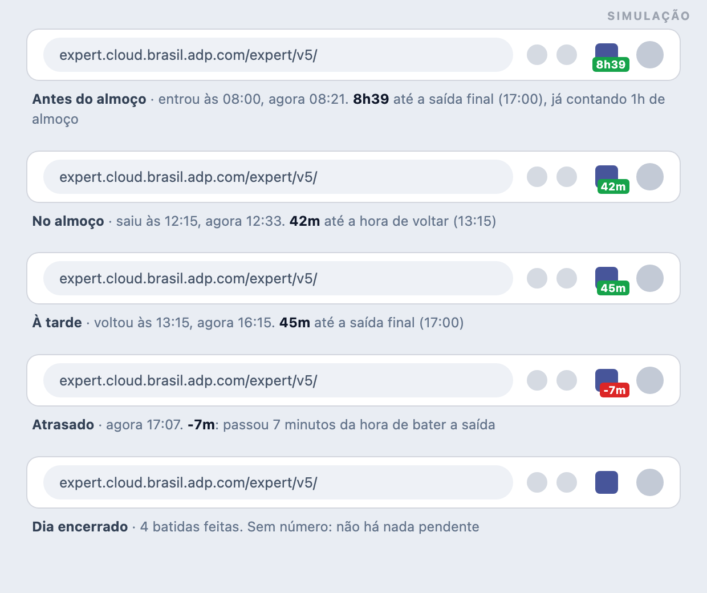
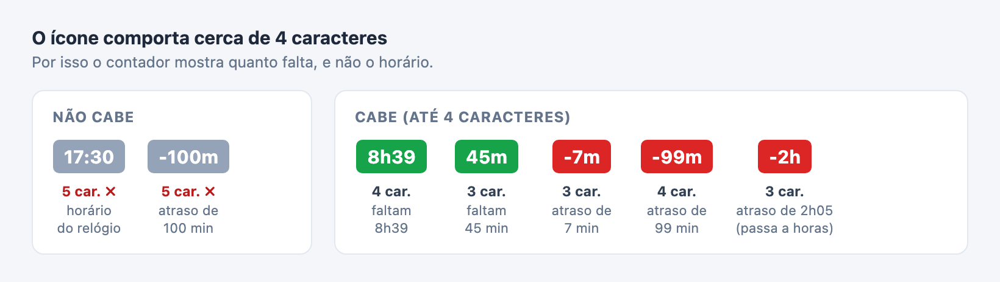

# ADP Hours — extensão Chrome para acompanhar o ponto

> Ferramenta pessoal e não oficial. Não tem vínculo com a ADP nem com a empresa.

**Versão atual:** 0.3.0

## O que é

Extensão do Chrome que lê a tabela de batidas de ponto da página da ADP e responde duas perguntas sem você precisar fazer conta:

- Quanto já trabalhei hoje?
- Que horas eu preciso bater o ponto para fechar 8h?

A resposta aparece em quatro lugares: um banner acima da tabela de ponto, um popup ao clicar no ícone da extensão, um contador direto no ícone na barra do Chrome e notificações quando chega a hora de bater o ponto.

## O que você precisa

- Google Chrome
- O arquivo `adp-hours-v0.3.0.zip`, anexado a esta página (ou acesso ao repositório privado: https://github.com/fernandokobayashi-telus/adp-hours)
- Node.js apenas se for rodar os testes (a extensão em si não precisa)

## Instalação

### Pelo arquivo zip (mais simples)

1. Baixe o `adp-hours-v0.3.0.zip` anexado a esta página.
2. Descompacte em uma pasta onde ele possa ficar, por exemplo `~/extensoes/adp-hours`. O Chrome lê a extensão direto dessa pasta, então não apague nem mova depois.
3. Abra `chrome://extensions` e ative o **Modo do desenvolvedor** (canto superior direito).
4. Clique em **Carregar sem compactação** e selecione a pasta que você descompactou (a que contém o `manifest.json`).
5. Abra a página de ponto da ADP: `https://expert.cloud.brasil.adp.com/expert/v5/`.

### Pelo repositório

1. Clone o repositório.
2. Siga os passos 3 a 5 acima, selecionando a pasta do projeto.

A extensão só atua no endereço da ADP e fica inativa em qualquer outro site.

### Atualizando para uma nova versão

1. Baixe o zip novo e descompacte por cima da pasta atual, substituindo os arquivos (ou rode `git pull` se instalou pelo repositório).
2. Em `chrome://extensions`, clique em **Recarregar** na extensão. Se aparecer um pedido de novas permissões, aceite.
3. Dê um refresh na aba da ADP.

## Como usar

### Banner

Aparece acima da tabela de batidas:

- **Trabalhado hoje:** tempo trabalhado até agora.
- **Saia às HH:MM para 8h:** horário de saída para completar 8h.
- **Volte às HH:MM · Saia às HH:MM:** quando você está no almoço.
- **✓ extras:** quanto passou das 8h.

### Ícone na barra do Chrome

O ícone mostra uma contagem regressiva até a **próxima batida que você precisa fazer**. O que conta como "próxima batida" muda ao longo do dia, e é isso que costuma confundir:



| Situação | O que o número mostra | Exemplo |
|---|---|---|
| Antes do almoço (1 batida) | Tempo até a **saída final**, já contando 1h de almoço | `8h39` às 08:21, com entrada às 08:00 |
| No almoço (2 batidas) | Tempo até a **hora de voltar** (1h depois da sua saída) | `42m` às 12:33, com saída às 12:15 |
| À tarde (3 batidas) | Tempo até a **saída final** | `45m` às 16:15 |
| Atrasado | Número negativo em vermelho: quanto passou da hora | `-7m` |
| Dia encerrado ou sem batidas | Sem número | ícone limpo |

Verde significa que ainda dá tempo. Vermelho significa que passou da hora.

**Por que `8h39` logo depois de entrar?** O horário do almoço varia de dia para dia, então a extensão não tenta adivinhá-lo. Antes do almoço, o contador aponta direto para a saída final e assume 1h de almoço no meio do caminho: entrando às 08:00, a saída é às 17:00 (8h de trabalho mais 1h de almoço), e às 08:21 faltam 8h39. Quando você bate a saída para o almoço, o contador passa a mostrar o tempo até a volta. Quando você volta, ele recalcula a saída final.

A contagem continua atualizando a cada minuto mesmo com a aba da ADP fechada, e sobrevive ao reinício do navegador. O valor de um dia anterior é descartado automaticamente.

#### Por que o formato é assim

O Chrome reserva espaço para cerca de 4 caracteres no selo do ícone. Todas as decisões de formato saem desse limite:



- **Tempo restante em vez de horário.** `17:30` tem 5 caracteres e não cabe. Um contador como `2h15` cabe e ainda mostra quanto falta, sem abrir nada.
- **Horas e minutos colados.** Com 1h ou mais o formato é `2h15`, sem espaço nem `:`, e os minutos sempre com 2 dígitos (`1h05`).
- **Só minutos abaixo de 1 hora.** `45m`, em vez de `0h45`.
- **Cor no lugar de palavra.** Não há espaço para escrever "atrasado". Verde quer dizer que ainda dá tempo, vermelho que passou da hora, e o `-` na frente reforça.
- **Atraso até 99 minutos fica em minutos** (`-99m`). Passou disso, `-100m` teria 5 caracteres, então o contador troca para horas inteiras, arredondadas para baixo: `-1h` de 100 a 119 minutos, `-2h` a partir de 2h. Perde precisão, mas continua cabendo.
- **Arredondamento para cima.** Com 20 segundos restantes aparece `1m`, para nunca mostrar `0m` antes da hora.
- **O detalhe completo fica no popup e no banner**, que não têm esse limite: horários exatos, tempo trabalhado e o lembrete do almoço.

### Popup

Ao clicar no ícone, o popup mostra as mesmas informações do banner. Quando você bateu apenas a entrada, ele também mostra um lembrete amarelo para não esquecer de bater o ponto do almoço.

### Notificações

O Chrome mostra uma notificação em dois momentos:

| Quando | Notificação |
|---|---|
| O 1h de almoço acabou | **Hora de voltar do almoço** |
| Chegou a hora da saída final (8h completas) | **8h completas** |

Como funcionam:

- Cada horário gera **uma única notificação**. Ela não se repete; o contador vermelho no ícone continua lembrando enquanto você estiver atrasado.
- Ela pode aparecer até 1 minuto depois do horário.
- Fica na tela até você fechar.
- Se você abrir a página da ADP depois do horário e ainda não tiver batido o ponto, o aviso aparece na hora.
- O Chrome precisa ter permissão para mostrar notificações no sistema. No macOS: Ajustes do Sistema → Notificações → Google Chrome. Sem isso, nada aparece.

## Regras de cálculo

A meta é 8h trabalhadas por dia, com 1h de almoço (CLT). Só entram as batidas do dia de hoje.

| Batidas hoje | Situação | Próxima batida (contador do ícone e notificação) |
|---|---|---|
| 0 | Não começou | nenhuma |
| 1 | Trabalhando (manhã) | saída final = entrada + 8h + 1h de almoço |
| 2 | No almoço | volta = saída do almoço + 1h |
| 3 | Trabalhando (tarde) | saída final = última entrada + (8h − tempo da manhã) |
| 4 ou mais, par | Dia encerrado | nenhuma |

O horário do almoço não é previsto, porque varia de dia para dia. O que importa é bater o ponto quando você sair e voltar: a saída sugerida é recalculada a cada batida.

Se o turno aberto já passou da hora prevista, o contador do ícone fica vermelho (atrasado) em vez de sumir.

## Limitações

- **Depende da página da ADP.** A extensão lê a tabela `data-testid="ctn_table-punchin"`. Se a ADP mudar esse HTML, a leitura para de funcionar sem aviso (aparece só um `console.warn`).
- **Precisa abrir a página de ponto.** Só a página da ADP conhece suas batidas. Se você bater o ponto e não abrir a página, o contador do ícone continua com o último valor conhecido.
- **Avisos fora de hora.** Se você bater o ponto pelo app da ADP no celular e não atualizar a aba do navegador, a extensão não sabe disso e pode avisar de um horário que você já cumpriu. Bater o ponto pela página da ADP evita isso.
- **Jornada fora do padrão.** Almoço de 30 minutos ou pausas longas que não são almoço geram uma sugestão errada até a próxima batida corrigir.
- **Fuso horário.** Usa o fuso do navegador.
- **Sem opções.** Meta de 8h e almoço de 1h são fixos no código.

## Privacidade e permissões

- Nenhum dado sai do navegador. Não há servidor, telemetria nem requisições externas.
- Permissões usadas:
  - acesso ao endereço da ADP (`host_permissions`), para ler a tabela;
  - `storage`, para guardar o horário da próxima batida e qual aviso já foi dado;
  - `alarms`, para atualizar a contagem do ícone a cada minuto;
  - `notifications`, para mostrar os avisos de fim de almoço e de 8h completas.

## Problemas comuns

| Sintoma | O que fazer |
|---|---|
| Banner não aparece | Abra a página de ponto (a que mostra a tabela de batidas) e dê refresh. |
| Popup diz "Abra a página de ponto da ADP" | A aba ativa não é a da ADP. |
| Popup diz "Página ainda carregando" | Dê refresh na aba da ADP. |
| `Extension context invalidated` no console | Você recarregou a extensão com a aba aberta. Dê refresh na aba. |
| Ícone mostra horário de ontem ou fica vazio | Abra a página de ponto da ADP uma vez para atualizar. |
| Notificação não aparece | Permita notificações para o Google Chrome nas configurações do sistema (no macOS: Ajustes do Sistema → Notificações) e confira se o modo Não Perturbe está desligado. |
| Extensão sumiu depois de mover a pasta | O Chrome lê a extensão da pasta descompactada. Volte a pasta para o lugar ou carregue de novo pelo passo 4 da instalação. |

## Desenvolvimento

```bash
npm install
npm test
npm run package   # gera adp-hours-v<versão>.zip
```

Estrutura:

- `src/lib/` — módulos puros e testados (leitura da tabela, cálculo, formatação, banner, contador do ícone, regra das notificações)
- `src/content.js` — observa a página da ADP, injeta o banner e avisa o service worker
- `src/background.js` — service worker que guarda a próxima batida, atualiza o ícone e dispara as notificações
- `src/popup.html` e `src/popup.js` — popup da barra do Chrome
- `docs/superpowers/` — especificação e plano da versão inicial
